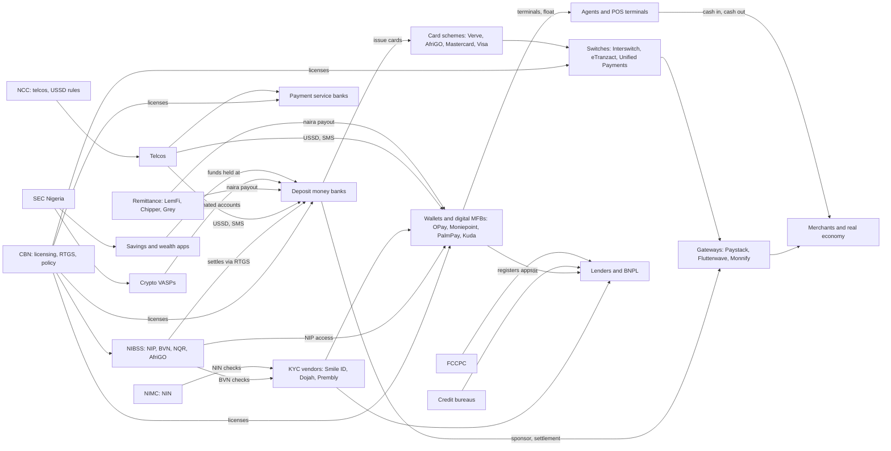

# How money and data move: the Nigerian fintech and tech value chain

Last verified: **2026-10-19**. Every figure carries its date and a source link. Where we could not find a defensible public number, the cell says so instead of guessing. Exchange rate conversions are ours and are labelled.

## The short version

Nigerian digital money runs on a small number of shared pipes owned or supervised by the Central Bank of Nigeria (CBN). Almost every naira that moves between two institutions passes through the Nigeria Inter-Bank Settlement System (NIBSS) and settles on the CBN's real time gross settlement system (RTGS). Banks still hold most deposits and the settlement accounts. Fintechs win on the edges: the app, the agent on the corner, the POS terminal, the checkout page and the credit decision. The edges are where the customer relationship lives, but the pipes are where the leverage lives.

Four things make this market different from most:

1. **Instant bank transfer is the default payment method, not cards.** NIBSS reported 11.2 billion transactions worth ₦1.07 quadrillion across its e-payment platforms in 2024, up 79.6% in value on 2023 ([S001], published 2025-01-29). At the 31 December 2024 rate of ₦1,535/$ that is about $702.6 billion ([S001]).
2. **Cash has not gone away, it has been franchised.** Agents with POS terminals turn digital balances into cash for a fee. NIBSS counted 8.36 million registered and 5.90 million deployed POS terminals in March 2025, with deployed terminals up 119.4% in a year ([S005], [S006]).
3. **Identity is the real gate.** A Bank Verification Number (BVN) and National Identification Number (NIN) decide which account tier a person gets, and therefore how much they can hold and move ([S118]).
4. **The biggest fintechs have become banks.** OPay, Moniepoint, Kuda and others hold microfinance bank (MFB) licences, and the CBN upgraded several of them to national MFB status in January 2026 ([S084]).

## Layer by layer

### 1. The central bank and settlement layer

| Component | What it does | Owner or operator | Key facts (dated) |
|---|---|---|---|
| CBN RTGS | Final settlement of interbank positions and large value payments | CBN | Supports ISO 20022, upgraded April 2023 ([S009], [S008]) |
| NIBSS Instant Payment (NIP) | Real time account to account transfers between banks, MFBs, MMOs and PSBs | NIBSS (owned by CBN and banks) | NIP settles on a deferred net basis through RTGS in sessions at 10:00, 15:00, 15:30 and 18:00 ([S007]) |
| NIBSS e-payment platforms (NIP plus NEFT, POS, NQR, others) | National switching for transfers and some card and QR flows | NIBSS | ₦1.07 quadrillion and 11.2 billion transactions in 2024 ([S001]); POS ₦18.15 trillion across 1.45 billion transactions in 2024 ([S003]) |
| National Payment Stack | ISO 20022 replacement for NIP | NIBSS | First live transaction 7 November 2025 ([S010]); CBN set a 31 October 2025 ISO 20022 compliance deadline for payment firms ([S008]) |
| eNaira | Central bank digital currency, launched October 2021 | CBN | The IMF found 98.5% of wallets inactive one year in ([S014]); about ₦18.3 billion in circulation, roughly 0.33% of currency, by 2025 ([S015]) |
| BVN database | Biometric identity for bank customers | NIBSS for CBN | 67.8 million enrolments at end of 2025, up from 63.5 million in 2024 ([S018]) |

**A note on conflicting rail numbers.** Vanguard's analysis of the same NIBSS 2024 data reports NIP at 10.47 billion transactions and ₦105 trillion, inside a ₦284.4 trillion total ([S002]), while Nairametrics and the Guardian report a ₦1.07 quadrillion NIBSS total ([S001], [S003]). The two are clearly different cuts of NIBSS tables. We use the ₦1.07 quadrillion headline because three outlets quote it from NIBSS directly, and we flag the gap rather than pick a side on the NIP sub-line.

The settlement layer is the first chokepoint. When a bank's core banking system fails, its customers' NIP transfers fail with it, and the fintech wallets that depend on that bank for settlement see failed or delayed credits. Ecofin's review of 2020 to 2025 argues that repeated bank outages during COVID, the 2023 naira redesign and later core banking migrations pushed retail users toward OPay and PalmPay ([S073], 2025-09-08). Punch reported that e-payment value actually fell in February 2023, to ₦37 trillion, as failed transactions piled up during the cash crunch ([S166]).

### 2. Banks: the balance sheet layer

Deposit money banks hold settlement accounts at the CBN, sponsor many fintechs into NIP, issue most cards and still earn the largest single revenue pool in the system: net interest income. Five tier one banks each booked more than ₦1 trillion of net interest income in 2024: Zenith ₦1.73 trillion, UBA ₦1.53 trillion, First Holdco ₦1.40 trillion, Access ₦1.26 trillion and GTCO ₦1.06 trillion ([S076]). Zenith and GTCO each crossed ₦1 trillion profit after tax ([S077], [S078]).

The CBN's March 2024 recapitalisation set new minimum capital of ₦500 billion for commercial banks with international licences, ₦200 billion for national and ₦50 billion for regional banks, with a 31 March 2026 deadline ([S082], [S126]). By April 2026 the CBN said 33 of 37 banks met the new thresholds and ₦4.65 trillion had been raised ([S083]). That capital wall is now one of the deepest moats in the system: it is the reason fintechs buy or upgrade MFB licences rather than apply for commercial banking licences.

### 3. Switches, processors and card schemes

| Player | Role | Disclosed metrics |
|---|---|---|
| Interswitch | Switch, processor, Verve card scheme, Quickteller, government collections | Revenue ₦137.5 billion and profit after tax ₦14.7 billion in the year to March 2025; Verve about 32% of revenue, core processing about 39%, non-transaction revenue ₦34.3 billion; Nigeria about 90% of revenue ([S040]) |
| Verve (Interswitch) | Domestic card scheme | Over 100 million cards issued across Africa by December 2025, more than 70 million in Nigeria ([S016]) |
| AfriGO (NIBSS and CBN) | National domestic card scheme launched 26 January 2023 ([S011]) | More than 1 million cards and over ₦70 billion in transactions by 2025 ([S012]); Moniepoint agreed to distribute 5 million AfriGO cards ([S013]) |
| eTranzact | Switch and payment processor, NGX listed | 2024 revenue ₦29.9 billion, profit after tax ₦3.39 billion ([S061]) |
| Unified Payments | Switch and processor | We found no recent public financials. Left blank. |
| Mastercard, Visa | International schemes | Nigerian scheme volumes are not published by NIBSS in a form we could cite. Left blank. |

Interswitch is the best example of how infrastructure players diversify. Its fastest growing line in the year to March 2025 was not card switching but non-transaction revenue such as e-invoicing for the Federal Inland Revenue Service and pension remittance platforms ([S040]). It was accredited as a FIRS e-invoicing access point provider ([S017]). In other words, the switch is turning into a government plumbing vendor.

### 4. Payment gateways, PSSPs and PSPs

Online merchants rarely connect to NIBSS or the schemes directly. They plug into a gateway that aggregates cards, bank transfer, USSD and virtual accounts.

| Player | Positioning | Disclosed metrics |
|---|---|---|
| Paystack (Stripe) | SME and enterprise online checkout, transfers, terminals | List price 1.5% plus ₦100 capped at ₦2,000 for local cards; dedicated virtual accounts 1% capped at ₦300; terminal cards 0.5% capped at ₦1,000 ([S048]); group profitable from February 2025 with seven profitable months in 2025 ([S047]); claimed over half of Nigerian online transactions in 2024 ([S050]) |
| Flutterwave | Enterprise and cross-border payments | Enterprise payments were 90% of revenue in 2024 ([S044]); by June 2025 monthly margin had doubled versus its 2024 average, with profitability "in sight" ([S045]); bought open banking firm Mono in January 2026 in an all-stock deal reported at $25 million to $40 million ([S046]) |
| Monnify (Moniepoint) | Collections via virtual accounts | Separate Monnify financials are not published. Left blank. |

The gateway layer sits on top of banks and switches and below merchants. Its chokepoint is settlement: a gateway needs a bank partner to hold merchant funds, and a breach or reconciliation error here is expensive. Flutterwave's October 2023 POS glitch let 814 merchants make 9,633 unauthorised transactions with ₦21.2 billion of exposure, of which ₦7.2 billion was preserved through account restrictions ([S138], [S139]).

### 5. Wallets, MMOs, PSBs and digital MFBs

This is where the consumer relationship moved between 2020 and 2026.

| Player | Licences | Disclosed scale |
|---|---|---|
| OPay | Mobile money operator (OPay Digital Services) and MFB (OPay Microfinance Bank) ([S036], [S038]) | 50.1 million monthly and 26.8 million daily users at 31 July 2026; 90.1 billion transactions worth $558 billion in the 12 months to 30 June 2026 ([S038], from the F-1 [S036]) |
| Moniepoint | MFB plus payments subsidiaries | ₦412 trillion processed and over 14 billion transactions in 2025; over 6 million businesses and over 16 million individuals banked; says it handled 80% of in-person payments ([S033]) |
| PalmPay | MMO and MFB | 16 million monthly active users in 2024 ([S052]); 35 million registered users and 15 million daily transactions in Q1 2025 ([S053]) |
| Kuda | MFB | 2024 group revenue $18.34 million and loss $5.83 million ([S054]) |
| Payment service banks (MoMo PSB, SmartCash and others) | PSB licence, ₦5 billion minimum capital ([S081]) | MoMo PSB had 2.7 million active wallets in H1 2025, far below its ambitions ([S062]) |

Licensed mobile money operators processed ₦71.5 trillion in 2024, up 53.4% from ₦46.6 trillion in 2023, across 3.9 billion transactions ([S004]).

The wallets depend on banks for one thing they cannot easily replace: settlement access to NIP through sponsor relationships or their own NIBSS membership. They depend on telcos for USSD and SMS, on NIBSS and NIMC for identity checks, and on POS hardware imported in dollars.

### 6. Agents and POS: the cash interface

Agents are small businesses that buy a terminal, hold a float and charge customers to deposit or withdraw cash. They sit between the formal and cash economies.

* Terminal costs rose 30% to 100% between 2023 and 2025. Entry level devices that cost ₦15,000 to ₦20,000 now sell for about ₦21,500, and Android smart terminals went from ₦30,000 to ₦40,000 up to ₦62,000 to ₦85,000, because all devices are imported ([S006], 2025-09-30).
* The CBN's October 2025 agent banking guidelines cap a customer's agent cash-out at ₦100,000 a day and ₦500,000 a week, and an agent's total cash-out at ₦1.2 million a day ([S114], [S115]). Terminals must be geo-fenced to the agent's registered location, with location and exclusivity rules from 1 April 2026 and a ₦5 million minimum penalty for geo-tagging breaches ([S115], [S116]).
* Agent cash-out fees are set by the market, not the CBN. Techpoint found ₦200 typical for a ₦10,000 withdrawal in 2025, with some agents charging ₦300 ([S168]). The FCCPC warned that association-set price lists could breach competition law ([S131]).

### 7. Identity, KYC and credit data

| Rail | Operator | Facts |
|---|---|---|
| BVN | NIBSS | 67.8 million at end of 2025 ([S018]) |
| NIN | NIMC | 127 million registrations by December 2025 ([S019]); NIMC sells verification access at negotiated levels ([S020]) |
| KYC aggregators | Smile ID, Dojah, Prembly, others | Dojah advertises identity checks from about $0.04 per check; most vendors use custom pricing ([S021]) |
| Account tiers | CBN | Tier 1 needs BVN or NIN; Tiers 2 and 3 need both; funded accounts missing them were restricted to "Post No Debit or Credit" from 1 March 2024 ([S118]) |
| SIM identity | NCC | Final NIN-SIM linkage deadline 14 September 2024, with unlinked lines barred ([S119]) |
| Credit bureaus | CRC, FirstCentral, CreditRegistry | Three CBN licensed bureaus ([S022]) |
| Global Standing Instruction | CBN and NIBSS | Lets a lender recover a defaulted loan from any BVN-linked account of the borrower ([S023]) |

Identity is a quiet chokepoint. Every wallet signup, loan and agent onboarding hits NIBSS or NIMC. NIBSS's 2024 fraud report described about ₦400 million moved through accounts opened with stolen identities of senior citizens, and over ₦1 billion moved through accounts created with BVNs registered for minors by compromised staff ([S136]). The weakest link in KYC is often an insider, not an algorithm.

### 8. Open banking

The CBN issued an open banking framework and, in March 2023, operational guidelines that make NIBSS the operator of the Open Banking Registry ([S024]). As of October 2025 the CBN said the system had not gone live ([S025]), and a later roadmap pointed to a phased rollout ([S026]). We found no source confirming full go-live by October 2026, so treat open banking as still pending. Meanwhile, private API aggregators filled the gap: Mono was bought by Flutterwave ([S046]), and Okra shut down in May 2025 ([S145]).

### 9. Telcos and USSD

USSD is still the channel for feature phone banking. A long fight over who pays for USSD sessions ended with the NCC's 2025 determination: ₦6.98 per banking USSD transaction of up to 120 seconds, billed to the customer's airtime ([S027], [S028]). Before that, telcos said banks owed them about ₦250 billion ([S029]); by June 2025 the figure had been revised to about ₦180 billion, of which 95% was recovered ([S030]).

### 10. Lending, BNPL and savings

* **Lending.** Credit is now where the wallets make most of their money. OPay's loan income was $236.1 million in H1 2026, more than its $130.6 million of payment revenue ([S037]). Moniepoint's MFB disbursed over ₦1 trillion of credit in 2025 ([S033]). FairMoney reported ₦121.9 billion revenue and a ₦68.5 billion loan book for 2024 ([S055]). Consumer lending apps sit under the FCCPC's 2025 digital lending regulations ([S111]).
* **Savings and wealth.** PiggyVest paid out ₦835 billion to users in 2024 and reported ₦1.3 trillion in payouts and over 6 million users in 2025 ([S060], [S059]). Wealth apps mostly sit on top of SEC licensed fund managers and custodians.

### 11. Cross-border and remittance

Formal diaspora remittances were about $21.8 billion in 2025, roughly flat on 2024 ([S164]). Flows through licensed IMTOs fell 11.78% to $2.07 billion in H1 2025 ([S165]). The January 2024 IMTO guidelines set minimum capital at $1 million (or naira equivalent for local firms), forced inbound payouts into naira and capped cash payouts below $200 equivalent ([S086], [S087]). LemFi said it had passed $1 billion in monthly volume when it raised a $53 million Series B in January 2025 ([S057]).

### 12. Crypto and VASPs

Nigeria received over $92.1 billion of crypto value between July 2024 and June 2025, the most in Sub-Saharan Africa ([S072]). The CBN reversed its 2021 bank ban on crypto in December 2023 ([S099], [S100]), and the Investments and Securities Act 2025 places virtual asset service providers under the SEC ([S094]). The SEC's ARIP programme is a transitional on-ramp, not a final licence ([S096]).

### 13. The real economy on top: commerce, mobility, energy, health and education

These sectors sit downstream of payments. They collect money through gateways and wallets, borrow through lenders and are hit hardest by FX because their costs are in dollars.

| Sector | Example players | Dependency on the stack | Dated signal |
|---|---|---|---|
| E-commerce | Jumia | Gateways, wallets, logistics | 2024 revenue $167.5 million, operating loss $66.0 million, with naira devaluation cutting dollar revenue ([S063]) |
| B2B distribution | TradeDepot, Omnibiz, Kobo360 | Working capital lending, collections | Kobo360 cut at least 30 of 50 Nigerian staff in November 2024 and paused most logistics ([S067]) |
| Mobility | Moove, Uber, Bolt | Driver financing, wallet payouts | Uber ended Nigerian operations in September 2026 ([S065]); Moove then exited, transferring about ₦35 billion of vehicles to drivers ([S064]) |
| Energy (PAYG solar) | Sun King, d.light, Lumos | Mobile money repayments, local currency debt | PAYG solar sales roughly halved in H1 2024 as devaluation hit imported kit ([S069]); Sun King closed an $80 million naira facility ([S068]) |
| Health | Helium Health, Medsaf | Payments, insurance, credit | Medsaf shut down in 2024 after raising over $7 million ([S155]) |
| Education | uLesson, Edukoya | Card and bank payments | Edukoya shut down in February 2025 after raising $3.5 million ([S148]) |

## Who depends on whom

The same edges are in [`data/value_chain_edges.csv`](../../data/value_chain_edges.csv) so you can load them into a graph tool.

## Chokepoints, ranked by how much damage a failure does

| Rank | Chokepoint | Why it matters | Evidence |
|---|---|---|---|
| 1 | NIBSS NIP and settlement | Nearly all interbank retail value passes through it | ₦1.07 quadrillion in 2024 ([S001]) |
| 2 | CBN licensing and directives | One circular can freeze onboarding for the biggest players | Onboarding pause on OPay, PalmPay, Kuda, Moniepoint and Paga from April to early June 2024 ([S088], [S089]) |
| 3 | Identity (BVN and NIN) | Decides account tier and limits; a target for insider fraud | 67.8 million BVNs vs 127 million NINs ([S018], [S019]); stolen identity fraud ([S136]) |
| 4 | Bank core systems | Outages push customers to wallets, but wallets still settle through banks | Failed transactions in 2023 ([S166]); Ecofin review ([S073]) |
| 5 | Imported hardware and FX | Terminals, servers and cloud are priced in dollars | POS prices up 30% to 100% ([S006]) |
| 6 | Telco USSD | Feature phone banking depends on telco billing | ₦250 billion dispute ([S029]) |

## What this means for builders

* **Do not compete with the pipes.** NIBSS, Interswitch and the big wallets are protected by licences, capital and settlement access. Products that sit on top of them (reconciliation, dispute handling, fraud monitoring, agent analytics) face lighter regulation.
* **The edges with the most friction are identity and reconciliation.** Insider fraud in KYC ([S136]) and failed transfer reversals ([S166]) are recurring pain points that are software problems as much as policy problems.
* **The real economy layer is where FX bites.** Mobility, solar and e-commerce firms that earn naira and spend dollars got hurt most between 2023 and 2026 ([S063], [S064], [S069]). See [`losses_and_leaks.md`](losses_and_leaks.md).

Related files: [`players_competition.md`](players_competition.md), [`regulation.md`](regulation.md), [`money_flows.md`](money_flows.md), [`SOURCES.md`](SOURCES.md).

<!-- reference links: generated by scripts/build_deep_dive_refs.py -->
[S001]: https://nairametrics.com/2025/01/29/e-payment-transactions-in-nigeria-hit-all-time-high-of-n1-07-quadrillion-in-2024/
[S002]: https://www.vanguardngr.com/2025/01/e-payment-transactions-rise-59-to-n284-4trn-in-2024/
[S003]: https://guardian.ng/business-services/business/nigerias-yearly-e-payment-transactions-break-n1-quadrillion-mark/
[S004]: https://nairametrics.com/2025/02/02/mobile-money-palmpay-opay-others-process-n71-5-trillion-transactions-in-2024/
[S005]: https://newtelegraphng.com/nibss-more-nigerians-embrace-pos-as-deployed-terminals-up-119-4-to-5-90m/
[S006]: https://nairametrics.com/2025/09/30/pos-terminals-cost-jumps-30-100-in-nigeria-over-two-years/
[S007]: https://africanenda.org/wp-content/uploads/siips_2025_NIP-Nigeria_CaseStudy_en.pdf
[S008]: https://nairametrics.com/2025/08/26/cbn-sets-october-31-deadline-for-payment-companies-to-comply-with-iso-20022/
[S009]: https://www.cbn.gov.ng/PaymentsSystem/LargeValuePayments.html
[S010]: https://www.westernpost.ng/nibss-completes-first-live-transaction-on-national-payment-stack/
[S011]: https://www.reuters.com/technology/nigeria-launches-domestic-card-scheme-cashless-bid-2023-01-26/
[S012]: https://afrigopay.com.ng/nigerias-debit-card-afrigo-has-now-processed-over-n70bn-in-transactions-in-2025/
[S013]: https://afrigopay.com.ng/afrigo-and-moniepoint-to-distribute-5-million-cards-drive-tap-to-pay-innovation-nationwide/
[S014]: https://www.imf.org/-/media/files/publications/wp/2023/english/wpiea2023104-print-pdf.pdf
[S015]: https://moneycentral.com.ng/economy/article/enaira-adoption-still-low-at-n18-3bn-about-0-33-of-bank-notes-in-circulation/
[S016]: https://interswitchgroup.com/news/verve-hits-100-million-cards-issued-reinforcing-leadership-in-africas-card/
[S017]: https://interswitchgroup.com/news/interswitch-named-firs-access-point-provider-for-mandatory-e-invoicing/
[S018]: https://nairametrics.com/2026/01/08/bvn-enrolments-hit-67-8-million-in-2025-buoyed-by-cbn-initiaves/
[S019]: https://thenationonlineng.net/nin-database-hits-127-million-enrolments-nationwide-says-nimc/
[S020]: https://nimc.gov.ng/nimc-verification-service
[S021]: https://dojah.io/blog/top-identity-verification-solutions-in-2024
[S022]: https://cban.ng/faq/
[S023]: https://www.cbn.gov.ng/Out/2020/CCD/CBN%20-%20Operational%20Guidelines%20on%20Global%20Standing%20Instructions%20GSI%20-%20Individuals.pdf
[S024]: https://www.cbn.gov.ng/Out/2023/CCD/Operational%20Guidelines%20for%20Open%20Banking%20in%20Nigeria.pdf
[S025]: https://www.ripplesnigeria.com/cbn-clarifies-open-banking-yet-to-go-live-says-system-launch-will-happen-soon/
[S026]: https://punchng.com/open-banking-roadmap-coming-in-three-months-cbn/
[S027]: https://ncc.gov.ng/sites/default/files/2025-04/USSD-DETERMINATION-2025.pdf
[S028]: https://leadership.ng/ussd-stands-at-n6-98-per-120-seconds-as-end-user-billing-begins-today/
[S029]: https://punchng.com/cbn-ncc-order-banks-telcos-to-settle-n250bn-ussd-debt-dispute/
[S030]: https://nairametrics.com/2025/06/19/banks-clear-95-of-n180-billion-ussd-debt-3-lenders-still-owing-alton/
[S033]: https://techpoint.africa/news/moniepoint-2025-report/
[S036]: https://www.sec.gov/Archives/edgar/data/2103076/000119312526418812/d56487df1.htm
[S037]: https://nairametrics.com/2026/10/13/opay-earns-more-from-lending-than-payments-as-profit-hits-90-9-million/
[S038]: https://www.techcityng.com/opay-ipo-filing-nyse/
[S040]: https://moneycentral.com.ng/exclusive/article/interswitch-navigates-fx-headwinds-moves-to-n14-7-billion-profit-after-prior-year-loss/
[S044]: https://flutterwave.com/us/blog/building-for-the-long-term-2024-in-review
[S045]: https://flutterwave.com/us/blog/scaling-with-purpose-h1-2025-at-flutterwave
[S046]: https://techcrunch.com/2026/01/05/flutterwave-buys-nigerias-mono-in-rare-african-fintech-exit/
[S047]: https://www.semafor.com/article/01/20/2026/paystack-eyes-growth-beyond-payments-with-restructuring
[S048]: https://paystack.com/pricing
[S050]: https://newtelegraphng.com/paystack-focuses-on-building-best-payments-growth-tools-for-african-businesses-akinlade/
[S052]: https://businessday.ng/technology/article/palmpay-served-10-million-monthly-active-users-in-2024-nwosu/
[S053]: https://nairametrics.com/2025/05/08/palmpay-hits-15-million-daily-transactions-in-q1-2025/
[S054]: https://businessday.ng/technology/article/breaking-kuda-cuts-losses-to-5-8m-as-fintech-shifts-focus-to-profitability/
[S055]: https://www.tekedia.com/fairmoney-revenue-surges-to-n121-9-billion-in-2024-amid-shift-to-customer-deposit-funded-lending/
[S057]: https://www.highlandeurope.com/lemfi-has-secured-53m-in-series-b-funding-led-by-highland-europe/
[S059]: https://techpoint.africa/news/piggyvest-2025-payouts/
[S060]: https://techpoint.africa/news/piggyvest-disburses-billions-users/
[S061]: https://doclib.ngxgroup.com/Financial_NewsDocs/43535_E-TRANZACT_INTERNATIONAL_PLC-_QUARTER_5_-_FINANCIAL_STATEMENT_FOR_2024_FINANCIAL_STATEMENTS_MARCH_2025.pdf
[S062]: https://www.tekedia.com/momo-psb-hits-2-7-million-wallets-as-growth-and-strategy-rebound-in-h1-2025/
[S063]: https://www.sec.gov/Archives/edgar/data/1756708/000175670825000005/jumia-ex991q42024.htm
[S064]: https://punchng.com/moove-exits-nigeria-transfers-n35bn-vehicles-to-customers/
[S065]: https://www.bbc.com/news/articles/c86xpv8l9y9o
[S067]: https://techcabal.com/2025/01/20/kobo360-layoff/
[S068]: https://www.ifc.org/en/pressroom/2025/sun-king-ifc-and-stanbic-ibtc-bank-close-80-million-debt-facility-to-expand-solar-
[S069]: https://gogla.org/reports/semi-annual-solar-market-report/insights-from-the-january-june-2024-sales-and-impact-data/
[S072]: https://www.chainalysis.com/blog/subsaharan-africa-crypto-adoption-2025/
[S073]: https://www.ecofinagency.com/insights/0809-48489-in-nigerian-bank-technology-failures-pushed-opay-and-palmpay-to-leadership-in-daily-payments
[S076]: https://businessday.ng/companies/article/zenith-uba-lead-nigerian-banks-with-trillion-naira-net-interest-income/
[S077]: https://nairametrics.com/2025/03/28/breaking-gtco-reports-record-n1-trillion-profit-after-tax-for-2024-fy/
[S078]: https://nairametrics.com/2025/03/27/zenith-bank-post-record-n1-trillion-profit-after-tax/
[S081]: https://www.cbn.gov.ng/Out/2020/CCD/APPROVED%20REVIEWED%20GUIDELINES%20FOR%20LICENSING%20AND%20REGULATION%20OF%20PAYMENT%20SERVICE%20BANKS%20IN%20NIGERIA-27AUG2020.pdf
[S082]: https://www.cbn.gov.ng/Out/2024/CCD/Recapitalization_MARCH_2024.pdf
[S083]: https://www.thisdaylive.com/2026/04/02/cbn-33-of-37-banks-met-new-capital-requirements-raised-n4-65trn/
[S084]: https://guardian.ng/business-services/money/cbn-upgrades-licences-of-major-fintechs-mfbs-to-national-status/
[S086]: https://www.mondaq.com/nigeria/fin-tech/1423338/revised-cbn-guidelines-on-international-money-transfer-services-in-nigeria
[S087]: https://nairametrics.com/2024/02/04/cbn-stops-outbound-international-money-transfer-transactions-limits-inflow-payouts-to-naira/
[S088]: https://nairametrics.com/2024/06/03/cbn-clears-opay-kuda-others-to-resume-new-customer-onboarding-this-week/
[S089]: https://techcabal.com/2024/06/03/cbn-lifts-onboarding-freeze/
[S094]: https://www.sec.gov.ng/documents/1319/Investments_and_Securities_Act_2025_x9rSXtI.pdf
[S096]: https://www.sec.gov.ng/about/resources/checklists/accelerated-regulatory-incubation-program-arip-checklist-for-vasp-onboarding/
[S099]: https://www.reuters.com/world/africa/nigerian-central-bank-lifts-ban-crypto-trading-2023-12-23/
[S100]: https://www.mondaq.com/nigeria/fin-tech/1414818/the-regime-for-the-operation-of-bank-accounts-by-virtual-asset-service-providersexchanges-in-nigeria
[S111]: https://fccpc.gov.ng/wp-content/uploads/2025/11/Digital-Electronic-Online-or-Non-Traditional-Consumer-Lending-Regulations-2025.pdf
[S114]: https://businessday.ng/business-economy/article/cbn-limits-daily-cash-withdrawals-via-agent-banking-to-n100000/
[S115]: https://punchng.com/cbn-caps-pos-agent-daily-transactions-at-n1-2m-in-new-guidelines/
[S116]: https://nairametrics.com/2025/10/07/pos-geo-tagging-cbn-sets-n5-million-minimum-penalty/
[S118]: https://www.cbn.gov.ng/Out/2023/PSMD/Circular%20on%20Tier%201%20Wallets%20&%20Accounts,%20Guidance%20Note%20&%20Profiling%20of%20Customers'%20Accounts%20&%20Wallets.pdf
[S119]: https://consumer.ncc.gov.ng/articles/92-ncc-announces-final-deadline-for-nin-sim-linkage-compliance-september-14-2024
[S126]: https://www.reuters.com/world/africa/nigerias-central-bank-sets-minimum-capital-base-banks-2024-03-28/
[S131]: https://fccpc.gov.ng/update-on-potential-anti-competitive-conduct-in-association-of-pos-operators-statement-of-setting-prices-for-services/
[S136]: https://nairametrics.com/2025/02/26/fraudsters-steal-n400-million-through-accounts-opened-with-stolen-identity-in-2024-nibss/
[S138]: https://nairametrics.com/2024/08/15/exclusive-nigerian-court-refuses-igps-request-to-reverse-billions-allegedly-withdrawn-from-flutterwave-in-2023-glitch/
[S139]: https://techpoint.africa/insight/a-fatal-error-by-nibss-worsened-flutterwaves-%e2%82%a621-billion-glitch/
[S145]: https://technext24.com/news/okra-blames-shutdown-on-market-challenge/
[S148]: https://nairametrics.com/2025/02/26/nigerian-edtech-startup-edukoya-shuts-down-4-years-after-raising-3-5-million/
[S155]: https://thecondia.com/medsaf-shutdown-drug-supply/
[S164]: https://www.vanguardngr.com/2026/05/diaspora-remittances-stabilises-at-21-8bn-in-2025-amid-global-pressures/
[S165]: https://nairametrics.com/2025/12/26/nigerias-imto-inflows-drop-11-78-to-2-07-billion-in-h1-2025/
[S166]: https://punchng.com/e-payment-falls-to-n37tn-as-failed-transactions-mount/
[S168]: https://techpoint.africa/insight/pos-withdrawal-charges-rise-as-agents-lament-cash-scarcity-and-rising-costs/
